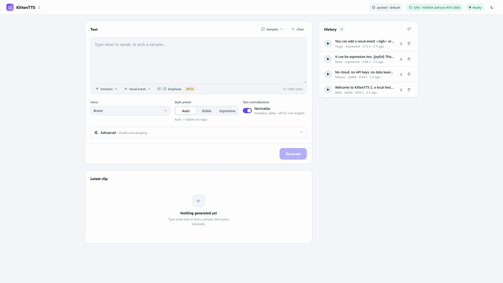

# KittenTTS 2 Web UI

A simple web page for turning text into speech with the KittenTTS 2 model, running entirely on your own Windows PC.

It comes with 47 built-in voices (38 English voices with different characters and moods, plus 9 language voices), ready-made sample texts, and a history of every clip you make.



Listen to samples: https://usamakhangt4.github.io/kitten-tts-webui/

[](https://github.com/UsamaKhanGT4/kitten-tts-webui/actions/workflows/ci.yml)

This is an unofficial project. It is not affiliated with or endorsed by KittenML or Stellon Labs.

## Quick start

Setup has two steps: get the code, then run `setup.bat` once. After that you only need `start.bat`.

Before you begin, install [Python 3.12](https://www.python.org/downloads/) (tick **Add python.exe to PATH**) and, optionally, [Git](https://git-scm.com/download/win). If you have an NVIDIA GPU, make sure the driver is 570 or newer (run `nvidia-smi` to check).

**Step 1: get the code.** Open a Command Prompt in a folder on a drive with about 12 GB free and run:
```
git clone https://github.com/UsamaKhanGT4/kitten-tts-webui
cd kitten-tts-webui
```
No Git? On the GitHub page click the green **Code** button, then **Download ZIP**, and unzip it.

**Step 2: run setup once.** In that folder, run `setup.bat` (or double-click it). It takes 5 to 15 minutes and downloads a few GB. If it prints a GPU warning, update your NVIDIA driver and run it again.

**Every time after that:** run `start.bat`. Your browser opens http://127.0.0.1:7860/. The first start downloads about 2.1 GB (the ~950 MB KittenTTS 2 weights plus the ~1 GB ResembleAI/chatterbox-turbo decoder), so give it a few minutes.

## Requirements

- **Windows 10 or 11.** The `setup.bat` and `start.bat` scripts are Windows-only.
- **An NVIDIA graphics card with 6 GB of video memory or more** is recommended. The model uses about 4.7 GB of VRAM while it is loaded. Setup installs the CUDA 12.8 build of PyTorch, which needs NVIDIA driver 570 or newer. Without a supported GPU it still runs on the processor (CPU), but it is slow for a 1.7B model.
- **NVIDIA driver 570 or newer.** To check, open a Command Prompt (press the Windows key, type `cmd`, press Enter) and run:
  ```
  nvidia-smi
  ```
  The top of the output shows `Driver Version`. If the command is not found or the number is lower than 570, install the latest driver from https://www.nvidia.com/Download/index.aspx.
- **Python 3.12** from https://www.python.org/downloads/. On the first screen of the installer, tick **Add python.exe to PATH** before clicking Install.
- **Git** (optional) from https://git-scm.com/download/win. If you don't want to install it, use **Download ZIP** as described above.
- **About 12 GB of free disk space** for the Python environment and the model. Everything is stored inside this folder, so put it on a drive with room. After setup finishes you can delete the `cache\pip` folder (about 2.8 GB) to free space.

## About the model

KittenTTS 2 is a 1.7B-parameter speech model, according to its [model card](https://huggingface.co/KittenML/kitten-tts-2). The model files are not bundled with this repository. The first run of `start.bat` downloads about 2.1 GB from Hugging Face: the ~950 MB packed KittenTTS 2 weights plus the ~1 GB ResembleAI/chatterbox-turbo decoder.

## What happens on first run

1. `setup.bat` creates a private Python environment in the `venv` folder and installs everything into it. This takes 5 to 15 minutes and downloads a few GB. It checks that PyTorch can see your GPU and prints a warning if it can't.
2. `start.bat` starts the server in a console window and opens http://127.0.0.1:7860/ in your browser. Leave the console window open; closing it stops the app.
3. The first time, the model is downloaded from Hugging Face into `cache\hf`. A banner at the top of the page shows **Downloading model... X%** and then **Loading model...**. Later starts skip the download and take from about 15 seconds to a few minutes.
4. When the banner disappears, the status pill says **Ready**. The badge next to it shows where the model runs: **GPU** with your card's name, or **CPU** (slow; see Troubleshooting).

You can type text while the model loads. If loading fails, the page shows the reason and what to check.

## Using it

- **Voices.** Pick a voice from the Voice list. English voices come first; language voices (Arabic, Chinese, French, German, Hindi, Italian, Portuguese, Russian, Spanish) are listed below them. For the language voices, turn **Normalize** off.
- **Samples.** The **Samples** menu fills in example texts with a matching voice and preset.
- **Presets.** **Stable** gives an even delivery and **Expressive** a looser one. **Auto** picks Expressive when the text contains tags and Stable otherwise.
- **Tags (experimental).** The toolbar under the text box can insert the model's emotion tags (such as `[joyful]`), vocal events (such as `<laugh>`) and `(((emphasis)))` markers. In our testing they made no audible difference, so don't rely on them. To change the mood of a clip, pick a different voice instead.
- **Generate.** Press **Generate** (or Ctrl+Enter in the text box). The clip plays in the Latest clip card and can be downloaded as a `.wav`.
- **History.** Every clip is saved in the `output` folder and listed under History, where you can play, download or delete it.
- **Advanced.** Change the model weights or decoder (this reloads the model) and sampling settings such as temperature and seed.

There is also a command-line example. From a Command Prompt in this folder:
```
venv\Scripts\python speak.py "Hello there." --voice Bruno
```

## Configuration

`setup.bat` copies `.env.example` to `.env`. Edit `.env` in Notepad to change settings, then restart `start.bat`. Relative paths are relative to this folder.

| Setting | Default | Meaning |
| --- | --- | --- |
| `KITTEN_WEBUI_HOST` | `127.0.0.1` | Address the server listens on. Keep the default (see Security). |
| `KITTEN_WEBUI_PORT` | `7860` | Port. Change it if 7860 is already in use. |
| `KITTEN_OUTPUT_DIR` | `./output` | Where generated clips are saved. |
| `KITTEN_CACHE_DIR` | `./cache` | Base cache folder. |
| `HF_HOME` | `./cache/hf` | Where the model is downloaded. |
| `KITTEN_TMP_DIR` | `./tmp` | Temporary files. |
| `KITTEN_SKIP_MODEL_LOAD` | `0` | `1` starts without loading the model (used by the tests). |

## Troubleshooting

**The badge says CPU, or setup.bat warned that the GPU was not found.**
Run `nvidia-smi` and check the driver version is 570 or newer. Update the driver, restart the PC, then run `setup.bat` again. If you have no NVIDIA GPU, the app still works on the CPU, just slowly.

**"The GPU ran out of memory."**
The model needs about 4.7 GB of free VRAM. Close other programs that use the GPU: unload the model in LM Studio or Ollama, and close games, video editors and other AI tools. Then press Generate again, or restart `start.bat` if the error appeared while loading. Shorter text also helps.

**The download is stuck or failed.**
The page shows "Could not download the model from Hugging Face". Check that the PC is online, that https://huggingface.co opens in your browser, and that a firewall, VPN, proxy or antivirus is not blocking Python. Check there is enough free disk space. Then close the console window and run `start.bat` again; the download resumes where it stopped.

**Port 7860 is already in use.**
Another program (often a second copy of this app, or another AI web UI) is using it. Close it, or set `KITTEN_WEBUI_PORT=7861` in `.env` and run `start.bat` again.

**"python is not recognized" or "Python was not found".**
Python is not installed or was installed without **Add python.exe to PATH**. Run the Python installer again, choose **Modify** or reinstall, and tick that box. Close and reopen the Command Prompt, then run `setup.bat` again.

**Antivirus blocks or deletes files.**
Some antivirus tools flag downloaded scripts or the large model files. Allow this folder in your antivirus, then run `setup.bat` again.

**setup.bat failed.**
Read the last lines it printed. Most failures are a lost connection or a full disk. To start clean, delete the `venv` folder in this folder and run `setup.bat` again. If it still fails, open an issue and include the full `setup.bat` output.

## Updating

If you used Git, open a Command Prompt in this folder and run:
```
git pull
setup.bat
```
If you used Download ZIP, download the new ZIP, unzip it to a new folder, and copy your `.env` and `output` folder (and `cache` if you want to keep the downloaded model) from the old folder. Then run `setup.bat` in the new folder.

## Security

The server has **no password or login**. By default it only listens on `127.0.0.1`, which means only your own PC can reach it. Do not change `KITTEN_WEBUI_HOST` to `0.0.0.0` and do not forward the port on your router: anyone who can reach it could use your GPU, reload the model, and read or delete your clips.

## License

This project has three parts with different licenses.

- **This web UI and the scripts in this repository** are released under the MIT License, Copyright (c) 2026 Usama Khan. See [LICENSE](LICENSE).
- **The `kittenml` Python package** (KittenML/KittenTTS), which setup installs as a dependency, is licensed under Apache License 2.0.
- **The KittenTTS 2 model weights** (`KittenML/kitten-tts-2` on Hugging Face) are licensed under the Stellon Labs Community License. They are **not** open source and are **not** included in this repository. They are downloaded from Hugging Face when you first run the app, and by doing so you must accept that license. Review it before any commercial use. In short, it allows non-commercial use and limited commercial use, requires attribution, and requires registration with Stellon Labs for commercial use. Read the full license on the model page before using the output: https://huggingface.co/KittenML/kitten-tts-2

This is an unofficial project, not affiliated with or endorsed by KittenML or Stellon Labs. The MIT license of this UI does not change the terms of the model. Your use of generated audio is governed by the model license.

## Contributing

Suggestions and fixes are welcome. In short: fork the repository, create a branch, make your change, run the tests, and open a pull request. The CI check must pass. Never commit model weights, audio files, `.env` files or personal paths. See [CONTRIBUTING.md](CONTRIBUTING.md) for details, and use the bug report template when opening an issue.

## Acknowledgements

KittenTTS 2 by KittenML and Stellon Labs. Built with FastAPI, PyTorch and the `kittenml` package.
